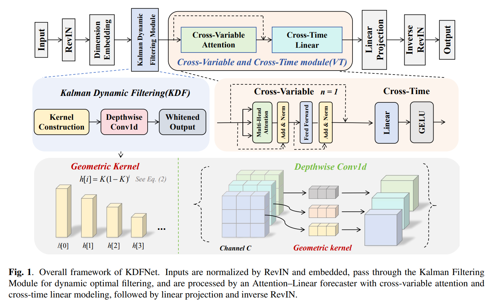
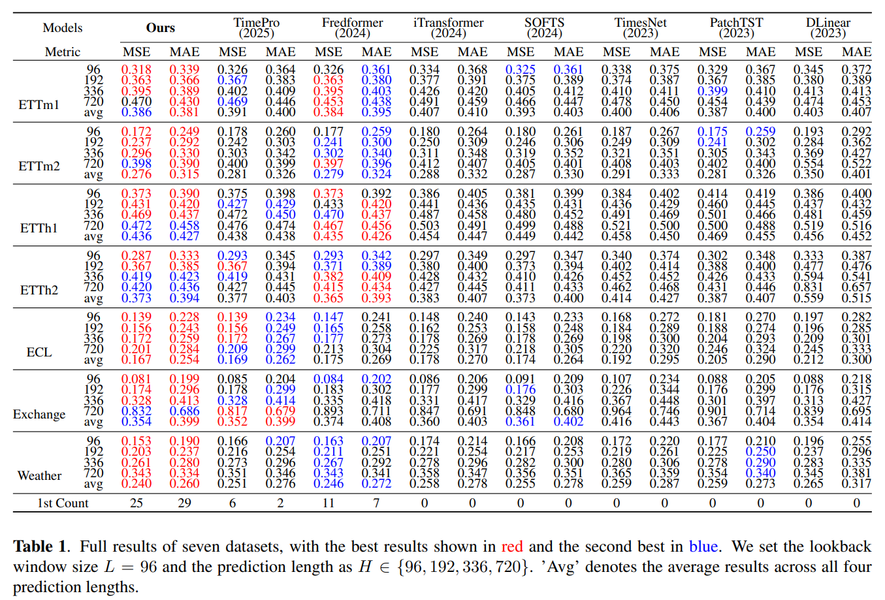

# KDFNet: Kalman Dynamic Filtering Network for Multivariate Time Series Forecasting

Official implementation of **KDFNet**, a lightweight Kalman-based framework for multivariate time series forecasting.

## Overview

Multivariate time series forecasting is challenging due to observation noise, dynamic uncertainty, and short-term fluctuations. Existing methods often entangle denoising with structural learning, making it difficult to robustly capture temporal evolution.

To address these challenges, we propose **Kalman Dynamic Filtering Network (KDFNet)**, which introduces adaptive Kalman filtering into multivariate time series forecasting.

KDFNet consists of two main components:

- **Kalman Dynamic Filtering (KDF):** Independently filters each channel using an adaptive steady-state Kalman filter. A geometric kernel and depthwise convolution are employed to achieve efficient temporal smoothing and noise suppression.
- **Cross-Variable and Cross-Time Module (VT):** Combines cross-variable attention to capture inter-variable dependencies with cross-time linear mapping to extract temporal dynamics.

This decoupled architecture improves forecasting robustness while maintaining model simplicity and computational efficiency.

## Framework

The overall architecture of KDFNet is illustrated below.

  

## Experimental Results

We evaluate KDFNet on seven widely used multivariate time series forecasting benchmarks:

- ETTh1
- ETTh2
- ETTm1
- ETTm2
- Exchange
- ECL
- Weather

**Experimental Settings:**
- Look-back window: `L = 96`
- Prediction horizons: `H ∈ {96, 192, 336, 720}`
- Evaluation metrics: Mean Squared Error (MSE) and Mean Absolute Error (MAE)
- Data split: 70% training, 10% validation, and 20% testing.

### Main Results

KDFNet achieves competitive performance across seven benchmark datasets, obtaining **25 best MSE results and 29 best MAE results** across the evaluated prediction settings.

  

## Ablation Studies

We conduct extensive ablation studies to investigate the contributions of the two key components:

1. **KDF Module:** Validates the effectiveness of Kalman-based dynamic filtering in suppressing noise and stabilizing temporal representations.
2. **VT Module:** Evaluates the importance of cross-variable dependencies and cross-time temporal modeling.

Additional experiments integrate KDF into iTransformer, PatchTST, and DLinear to further investigate its effectiveness as a general filtering component.

## Code and Reproducibility

The implementation, experimental configurations, and reproduction instructions are provided in this repository.

Detailed training and evaluation commands will be updated alongside the corresponding code and scripts.

## Citation

If you find this work useful in your research, please consider citing our paper:

**KDFNet: Kalman Dynamic Filtering Network for Multivariate Time Series Forecasting.**

Ziqiong Li, Heyu Chai, Shengjun Liu, Wenzhen Yue, and Xinru Liu.

IEEE International Conference on Acoustics, Speech and Signal Processing (ICASSP), 2026.

\noindent\textbf{Contact:} 
For any questions, please contact Ziqiong Li, 
Central South University, China. 
Email: \href{mailto:1318176501@qq.com}{1318176501@qq.com}.
